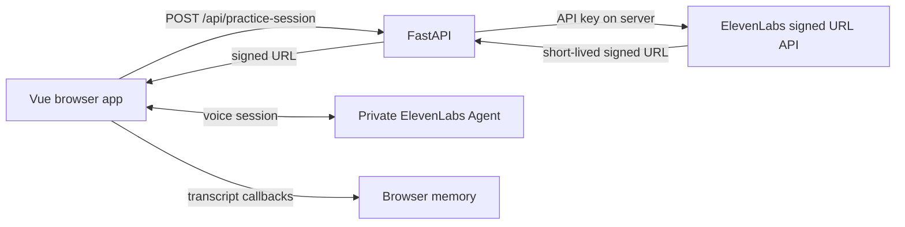

# Architecture

## Session flow

1. The app asks its FastAPI service for a new session. FastAPI reads `ELEVENLABS_API_KEY` and `ELEVENLABS_AGENT_ID` from its environment and requests a signed URL from ElevenLabs.
2. The browser gives the signed URL to `@elevenlabs/client`, obtains microphone access, and connects directly to the private agent. The key never enters browser code or the signed URL response.
3. The browser uses session callbacks for connection state and transcript text. CaseRoom keeps this text in memory for the reflection view and clears it on refresh or retry. The backend does not store audio or transcripts.

ElevenLabs [recommends signed URLs for client-side applications](https://elevenlabs.io/docs/eleven-agents/customization/authentication); they expire after 15 minutes for starting a connection. The backend adds a small in-memory per-client issuance limit and returns generic provider errors. The limit resets if the server restarts and is not a substitute for user authentication or a shared rate-limit store on a public deployment.

## Privacy and scope

CaseRoom uses one fictional case and has no account or database. Candidates should not speak real client details. Although CaseRoom does not persist transcripts, ElevenLabs may store conversation transcripts and audio according to the agent's [retention](https://elevenlabs.io/docs/eleven-agents/customization/privacy/retention) and [audio-saving](https://elevenlabs.io/docs/eleven-agents/customization/privacy/audio-saving) settings. Configure those settings before sharing a live demo.

The reflection view is a set of prompts based on the [SRA client-interview skill criteria](https://sqe.sra.org.uk/assessments/sqe2-assessments/sqe2-specification/sqe2-assessments). It is practice guidance, not an official mark or legal assessment.
